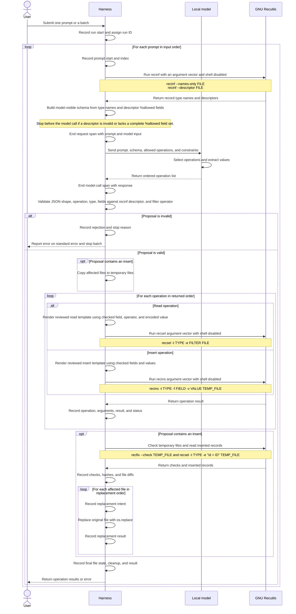

# Reckless harness feature specification

## Purpose

Reckless lets a user find and save research records through natural language.
The harness gives a local model the user's request and a list of the collection's
record types and fields. The model returns read or insert operations in JSON.
The harness checks the response, runs fixed Recutils commands, checks temporary
file copies, and replaces the originals when needed. One OpenTelemetry trace
per run records every harness step and model interaction.

This document defines the version 1 scope, request flow, model contract, trace
requirements, and test plan. The open questions are not part of the contract.

## Scope

Version 1 supports read and insert operations. Each record type has its own
`.rec` file. The harness uses GNU Recutils to find the record types and fields
before each model call.

At discovery, enumerate the `.rec` files in the configured collection
directory and run `recinf --names-only` on each file. Each file must contain
exactly one named record type, and each type must map to exactly one file. The
harness uses this mapping for reads and inserts. Stop before the model call if
a file is invalid, has no named type, or duplicates a type found in another
file. Read each file's descriptor with `recinf --descriptor` and verify that
its `%rec` type matches the discovered name. The descriptor is the source of
the model-visible field rules. Each type must declare `%allowed` with the
complete set of fields the model may read or insert; if it is absent, stop
before the model call because the harness cannot establish a complete field
allowlist from the descriptor.

The command line accepts one prompt or a batch of prompts. The harness handles
batch prompts in order and makes a separate model call for each one. Each prompt
is independent. The model does not receive earlier prompts or results, so a
prompt cannot depend on an earlier prompt.

A prompt may produce multiple operations. The harness runs them in the order
returned by the model. Reads use the original files as they were when the prompt
began. The harness does not pass a read result to a later operation. Inserts go
into temporary file copies until validation succeeds.

Version 1 does not support updates, deletes, operations that depend on earlier
results, or clarification questions.

## Design choices and alternatives

The Python harness runs GNU Recutils with an argument vector and leaves shell
interpretation disabled. Human-reviewed operation templates define how checked
model JSON becomes `recsel` or `recins` arguments. Invoking commands through
Bash would add shell parsing without helping the harness call Recutils. Python's
[`subprocess`](https://docs.python.org/3/library/subprocess.html) supports
direct process calls and captured output.

The model prompt requests the required JSON shape, and the harness validates
the parsed response before use. A typed schema validator can check fields and
types, but it does not make a Recutils expression safe. Templates accept only
validated fields, values, and explicitly supported operators, and use
Recutils-specific encoding. Pydantic is one possible Python validator, not a
security boundary by itself.

The trace uses OpenTelemetry's `ConsoleSpanExporter` with a local file stream.
An OTLP exporter and Collector could send spans to a separate service, but that
adds a process and a network endpoint. A custom JSON writer would duplicate
span serialization already provided by the SDK.

Inserts use temporary copies and one-file-at-a-time replacement. Editing
original files directly would expose them to partial command failures before
validation. The chosen approach protects originals until replacement begins,
but a multi-file replacement is not atomic. A transaction journal or automatic
recovery would add behavior that version 1 does not require.

## Command line input

Users pass one prompt or repeat `-p` / `--prompt` for a batch:

```sh
reck --prompt "Find the launch note"

reck --prompt "Find the launch note" \
     --prompt "Add a design review event for Friday"
```

For scripted batches, `--requests-file` accepts a JSON file containing an array
of prompt strings. A value of `-` reads the same JSON array from standard input.

```json
[
  "Find the launch note",
  "Add a design review event for Friday"
]
```

Follow the [Command Line Interface Guidelines](https://clig.dev/). Write successful read results to
standard output in Rec format. Write errors or guidance to standard error.
Return zero when the run succeeds and nonzero when input, model, command, or
harness processing fails. If an earlier prompt succeeds before a later prompt
fails, keep its result and stop before later prompts. With no input, show
concise help. Do not prompt for input when standard input is not a terminal.

Reject conflicting input sources, empty or whitespace-only prompts, an empty
prompt list, and malformed JSON before calling the model or changing collection
files. Report the input error on standard error and return nonzero.

## Model tasks

The model must perform these tasks, alone or in combination:

- Select a record type and, for a read, the field to filter on.
- Select an operation, such as read or insert.
- Extract values for read filters or inserted fields.
- Combine one or more intents into an ordered list of operations.

Here, entity extraction means selecting a record type and a field used to find
records. A hybrid prompt combines more than one task or asks for multiple
operations. The model may return several operations, but version 1 does not pass
a read result to a later operation.

Compare local instruction models on labeled examples for each task and for
combined prompts. Consistent output in the required JSON contract is an
explicit model objective and evaluation dimension. Use code to check JSON
validity, schema conformance, operation, record type, field names, extracted
values, and operation order. No model or model size has been selected.
Fine-tuning may target consistent contract-shaped output as well as task
accuracy, especially if prompt changes and examples do not produce reliable
format adherence. The harness must still validate every response and reject
invalid output.

## Model input contract

The harness sends one JSON object for each prompt. The model receives no earlier
batch prompts or results.

```json
{
  "contract_version": "1",
  "request": "Find the launch note",
  "collection_schema": [
    {
      "type": "Notes",
      "fields": ["id", "title", "body", "tags"]
    },
    {
      "type": "Events",
      "fields": ["id", "title", "date", "notes"]
    }
  ],
  "allowed_operations": ["read", "insert"],
  "constraints": [
    "Return only the JSON object described by the output contract.",
    "Use only the listed record types and fields.",
    "Preserve the intended order of operations.",
    "Do not assume that results are passed between operations."
  ]
}
```

The record types and fields above are examples. The harness builds the list
from the record names and `%allowed` fields in the descriptors returned by
`recinf`. The draft contract does not send saved record contents to the model.

## Model output contract

For a request that can be handled, the model returns one JSON object with an
`operations` array. The order of the array is the order in which the harness
runs the operations. The model returns JSON only. It does not return
shell commands or claim that an operation succeeded.

The example uses `contains` to show the output shape. The read Jinja template
defines the supported filter operators and how multiple filters combine.
Insert proposals omit `id`. Each record set declares
`id` as an integer `%auto` field and a `%key`; Recutils assigns the next unused
integer when `recins` inserts a record without an explicit ID. The harness
checks the inserted record read back from the temporary file.

```json
{
  "operations": [
    {
      "kind": "read",
      "type": "Notes",
      "filters": [
        {"field": "title", "operator": "contains", "value": "launch"}
      ]
    },
    {
      "kind": "insert",
      "type": "Events",
      "fields": {
        "title": "Launch review",
        "date": "2026-10-23"
      }
    }
  ]
}
```

The harness rejects malformed output, unknown keys, wrong value types, unknown
record types, fields outside the descriptor's `%allowed` set, and unsupported
operations before running a command. It checks filter fields and insert fields
against the same descriptor. The harness builds command arguments from checked
values. It never runs command text returned by the model.

The model prompt guides the response but does not validate it. The harness
parses and validates the response against a typed schema and the selected
record descriptor before execution. `recinf --descriptor` supplies the
declared rules; the harness checks type and field membership, while the
descriptor's `%allowed` field set defines the complete model-visible field
allowlist. A schema library such as Pydantic may check the JSON shape, but it
does not replace these descriptor checks. The harness builds each selection
expression and insert command from validated JSON using human-reviewed,
operation-specific Jinja templates. The model never supplies a command or raw
Recutils expression. The read template defines the supported operators and
how multiple filters combine, and maps checked fields and values to Recutils
expressions. The insert template maps checked fields and values to `recins`
arguments. An operator without an explicit read-template mapping is rejected.
The operator set and filter-combination rule are implementation decisions made
while building and reviewing the read template, then covered by harness tests.
For inserts, the harness applies the proposed record to a temporary file and
runs `recfix` to check the descriptor's declared types and integrity
constraints before file replacement.

Jinja templates produce Recutils expressions or argument arrays, never a Bash
command string. The harness invokes a fixed Recutils executable with an
argument vector and shell interpretation disabled. Templates use explicit
Recutils-literal and, where needed, regular-expression escaping helpers.
Jinja's general string substitution or HTML escaping is not a Recutils
encoder. Template behavior and escaping helpers require tests for quotes,
backslashes, newlines, and expression or regular-expression syntax characters.

Each operation has a `kind` of `read` or `insert` and a record `type` from the
supplied list. A read contains filters. Each filter has a field, operator, and
string value. An insert contains field names and string values. The harness
checks field names and value types, then checks required fields and Recutils
rules against the collection and temporary files.

## Request flow



For each prompt that inserts records, the harness makes one temporary copy of
each affected file. It applies all inserts to the copies, checks them, and reads
the new records back. Temporary copies must be on the same file system as the
original files so the harness can replace each file with a rename. Create the
copies with unique names that do not end in `.rec`, so collection discovery
does not treat them as source files. Remove them on every handled success or
error path. If the process exits unexpectedly, the next run removes stale
copies after it acquires the collection lock.

Before collection discovery, acquire a nonblocking exclusive advisory lock with
Python's `fcntl.flock` on `.reckless.lock` in the collection directory. Hold it
for the full run, and require every Reckless process to use the same lock. If
another run holds the lock, report that the collection is busy and exit
nonzero. The operating system does not lock an open file automatically. This
lock coordinates Reckless processes that honor it; it does not block an
external editor that ignores it.

The harness replaces files one at a time. If a replacement fails, earlier file
changes remain, and later files are not replaced. The batch stops, and the
file-replacement spans record which files changed and which did not when trace
export succeeds. If a failure happens before replacement begins, the harness
removes the temporary copies and leaves the original files unchanged for that
prompt. Earlier successful prompts remain saved.

## OpenTelemetry trace capture

Attempt to capture one OpenTelemetry trace per `reck` invocation, called a run.
A run can contain one prompt or a batch of prompts. Use a root span for the run
and child spans for prompts, model calls, operations, commands, and file
replacement. Record ordered events on spans for steps that do not need their
own duration. Add `run_id`, `prompt_index`, and `operation_index` attributes as
applicable. OpenTelemetry trace and span IDs provide additional correlation.
Trace capture is best effort: an export failure does not stop or alter harness
processing. A trace may be partial or missing, and a person reviews the trace
and OpenTelemetry SDK diagnostics.

### Event inventory

This is the event inventory the harness emits as spans and span events. The
harness is responsible for instrumentation. GNU Recutils does not write a
separate trace. OpenTelemetry SDK diagnostics are separate from the trace and
are covered below.

| Stage | Event | Information to capture |
| --- | --- | --- |
| Run | `run_started`, `run_finished` | Run ID, input mode, start/end time, prompt count when known, final status, and stop reason. Do not duplicate prompt contents in run events. |
| Input | `input_loaded`, `input_error` | Input mode, parsed prompt count when valid, and read or JSON validation error when invalid. Do not record prompt text here. |
| Prompt | `prompt_started`, `prompt_finished` | Prompt index, final status, result or error summary, failure stage when applicable, and whether later prompts were skipped. |
| Command | `command_started`, `command_finished` | Executable and argument vector, working/target file, start/end time, exit status, stdout, stderr, and launch exception. This includes `recinf`, `recsel`, `recins`, and `recfix`. |
| Model request | `model_request` span | Exact incoming prompt and structured model input. End it before the model call; export is best effort and does not gate the call. |
| Model call | `model_response` or `model_error` | Model name/version/settings, response time/duration, and exact raw response or exception details. Link it to the request by run ID and prompt index. |
| Validation | `proposal_validation` | Pass/fail, parsed operations when valid, and specific rejection reasons when invalid. |
| Operation | `operation_started`, `operation_finished` | Operation index, kind, record type, checked fields/filters, result summary, status, and error. Preserve model-proposed order. |
| Temporary files | `temporary_file_created`, `temporary_file_checked`, `temporary_file_removed` | Original/temp paths, action, check outcome, hashes, and cleanup result. |
| File replacement | `file_replace_intent`, `file_replace_result` | Target/temp paths, before/after hashes, replacement order, result or exception. Emit intent before attempting the rename and result immediately afterward. |

Every span and event should carry a timestamp and correlation identifiers:
`run_id`, `prompt_index` when it belongs to a prompt, and a monotonically
increasing `event_sequence` within the run. Operation and command spans/events
also carry their operation index where applicable. Sequence numbers define
order; timestamps support duration and timing analysis. A command failure
should record as much of the command, exit status, and stderr as the harness
successfully observed. A failure to
launch a command records the launch exception because there may be no exit
status or command output.

The Python harness runs each GNU Recutils executable with a subprocess argument
vector and leaves shell interpretation disabled. The harness captures the
process status, stdout, stderr, and launch errors. Recutils does not write a
separate trace.

Record validation, command results, file paths/hashes/diffs, replacement intent
and result, cleanup, stop reason, and user result in the relevant harness spans
or span events. The request span holds the exact prompt and model input. The
model-call span holds the raw response or exception and timing. Do not duplicate
full prompt or response content in unrelated spans. Treat prompts, model
inputs/responses, command arguments, stdout, and stderr as potentially
sensitive.

Use Python's `ConsoleSpanExporter` with a file-like output opened in append
mode. Its default formatter serializes each ended span as JSON followed by a
newline and flushes the output stream. Set `RECKLESS_TRACE_DIR` to the local
trace directory and write a distinct trace file per run. Route OpenTelemetry
SDK diagnostics through Python logging to
`RECKLESS_TRACE_DIR/reckless-opentelemetry-diagnostics.log` for human review.
Trace and diagnostics files are review artifacts. If the trace directory or
exporter is unavailable, the harness continues; the trace may be partial or
missing. This local setup requires neither a Collector nor Docker. Configure
an always-on sampler so every harness run is sampled. Do not use a batch
processor when processing each run as a short-lived CLI command unless
shutdown/flush behavior is explicitly handled.

Spans are exported when they end. End the request span before invoking the
model and record model, command, and file events as the run proceeds. Export
failure at any point, including before the model call or after a file
replacement, does not stop processing, trigger a retry, or roll back a file
change. The Python OpenTelemetry SDK's diagnostic messages support human
review; the harness does not inspect them or treat them as a control signal.

Trace files belong to the local operating-system user who runs Reckless. That
user can read or delete them at any time. Version 1 has no separate access
control or retention system. Harness failures belong in harness evaluation,
not model-training data. Traces preserve the events, inputs, and outputs of the
run under the contract in effect at that time. A later contract or interface
change does not change historical traces.

A person reviews traces and records the run ID, prompt index, failure class
(`model_error`, `harness_error`, `test_data_error`, `unclear_contract`, or
`no_failure`), review status, evidence references, reviewer, and review time.
The review can inform training data curation, but a person must separately
choose training examples and approve their targets. Code evaluates objective
rubric criteria such as schema validity, command status, and final file
contents. The review-record format remains open.

## Synthetic data and harness tests

Synthetic cases test how the model reads requests and how the harness behaves.
A prompt alone cannot reliably make a Recutils command or file replacement
fail. Use prepared collection files and inject failures at named steps.

Cover these cases:

| Area                  | Cases                                                                                                    |
| --------------------- | -------------------------------------------------------------------------------------------------------- |
| Command line input    | One prompt, repeated `-p`, JSON file, JSON from standard input, no input, conflicting input sources, empty prompt, empty prompt list, malformed JSON |
| Record-file discovery | One named type per file, duplicate type across files, missing type, malformed descriptor, missing or incomplete `%allowed` field declaration |
| Batch position        | All succeed, first prompt fails, middle prompt fails, last prompt fails                                  |
| Model result          | Valid response, malformed response, invalid type or field, model error                                   |
| Model tasks           | Record type and field selection, operation selection, value extraction, combined tasks, multiple intents |
| Operations            | One operation, multiple reads, multiple inserts, mixed operations, proposal order                        |
| Collection state      | One match, no match, multiple matches, missing required field, constraint failure                        |
| Write set             | Multiple inserts to one file, inserts across files, repeated record types                                |
| Temporary file checks | `recins` failure, `recfix` failure, reading inserted records, cleanup before replacement, stale copy cleanup after an unexpected exit |
| Concurrent runs       | A second Reckless run reports a busy collection lock and exits nonzero; no overlapping Reckless writes    |
| File replacement      | Successful replacement of several files, injected failure on the second or later file                    |
| Filter expression     | Values with quotes, backslashes, newlines, and expression or regular-expression syntax characters are treated as values, not expression syntax. |
| Batch effects         | Earlier successes remain, failed prompt stops the batch, later prompts have no effects                   |


The table is the complete required case list. The topic tree groups cases by
subject and does not repeat every injected failure. Vary wording, record types,
starting collection state, and prompt position within each family.

```text
Request handling
├── Input form
│   ├── One prompt
│   ├── Repeated -p prompts
│   ├── JSON file
│   └── JSON from standard input
├── Batch processing
│   ├── Every prompt succeeds
│   ├── First prompt fails
│   ├── Middle prompt fails
│   └── Last prompt fails after earlier successes
├── Model response
│   ├── Valid read or insert
│   ├── Invalid type, field, or operation
│   ├── Incomplete or malformed output
│   └── Model error
├── Model tasks
│   ├── Record type and filter field selection
│   ├── Operation selection
│   ├── Filter and field value extraction
│   └── Multiple intents and operations
├── Collection and files to change
│   ├── One, no, or multiple read matches
│   ├── Multiple inserts to one file
│   ├── Inserts across files
│   ├── Invalid or duplicate file descriptors
│   └── Lock contention and stale temporary copies
└── Temporary files and replacement
    ├── Command or check failure before replacement
    ├── Successful file replacement
    ├── Failure on the second or later file replacement
    └── Human review compares available trace events and SDK diagnostics with the run steps
```

Start with hand written example cases, including pairs that differ in one
important detail. Generate wording variations from reviewed examples while
keeping the intended operations and outcomes fixed. Review each variation for
realistic wording, fit with its scenario, and duplication. Prepare collection
files for cases such as no matches, multiple matches, and constraint errors.
For batches, vary the number of prompts and place failures at different
positions. Include an observable later prompt so a test can check that it did
not run after an earlier failure.

For each scenario, record:

- A scenario ID, coverage tags, input form, and prompt list.
- The initial collection files and expected model call for each reached
prompt.
- The expected operations, checked arguments, operation order, and file
replacement order.
- The expected commands and permitted side effects.
- The expected stop point and prompts that must not run.
- The expected collection state after each prompt and after the batch.
- The expected user result or error and required OpenTelemetry spans and events.

For a failure while replacing files, check changed and unchanged files
separately. During human trace review, compare any available trace events and
SDK diagnostics with the observed file state. Recovery behavior is unresolved,
so do not score it.

Trace review is a human operation. Reviewers compare the available trace and
OpenTelemetry SDK diagnostics with the expected run steps and mark whether the
trace appears complete, partial, or unavailable. A trace export problem does
not change harness execution or decide whether an example is selected for
model training.

Review synthetic examples against these checks:

- The example follows the version 1 contract and tests behavior that is not
already covered by a very similar example.
- The expected result is explicit and repeatable.
- Any command failure is injected at a named step.
- The expected OpenTelemetry spans and events are stated.
- A person sets or reviews the expected result independently of the model.

Keep cases used to change prompts separate from evaluation cases used to measure
performance. Add new cases and update the failure categories when trace review
finds a new failure type.

## Trace review and model training

Review the available OpenTelemetry trace and SDK diagnostics. Model-request
and model-call spans show the incoming prompt, exact model input, and raw
response; harness spans show validation, commands, file changes, and the
reported outcome. Mark the trace complete, partial, or unavailable. Classify
each failure as a model error, harness error, test data error, or unclear
contract. Keep training and prompt-development cases separate from evaluation
cases.

The model-behavior questions below determine expected outputs and coverage for
model-development and evaluation data. Resolve them before assigning gold
targets to cases. Contract and interface versioning, including how unclear or
unsupported requests are represented, remains open for model evaluation.

## Open questions

### Model behavior and evaluation

- How should contract and interface versions be represented and handled,
  including the JSON response for unclear, unsupported, or no-operation
  requests? Settle expected responses and pass criteria through model
  evaluation. One possible starting point is to select the model checkpoint
  through configuration such as a `RECK_MODEL_CHECKPOINT` environment variable
  and bind that checkpoint to the contract it supports in checkpoint metadata
  or a manifest. The harness could validate the pairing and record both the
  checkpoint identity and contract identifier in the trace. If a checkpoint is
  dedicated to one contract, the contract identifier might not need to be sent
  in every model request. This is a proposal to evaluate, not a decision; it
  does not define the JSON response for unclear, unsupported, or no-operation
  requests.
- What pass criteria should a model meet for consistent contract-shaped output,
  record type and field selection, operation selection, value extraction, and
  combined prompts? Should confidence scores be part of the contract, and if so,
  how should they be validated?
- How should the model order multiple intents when the prompt does not make
  their intended order clear?
